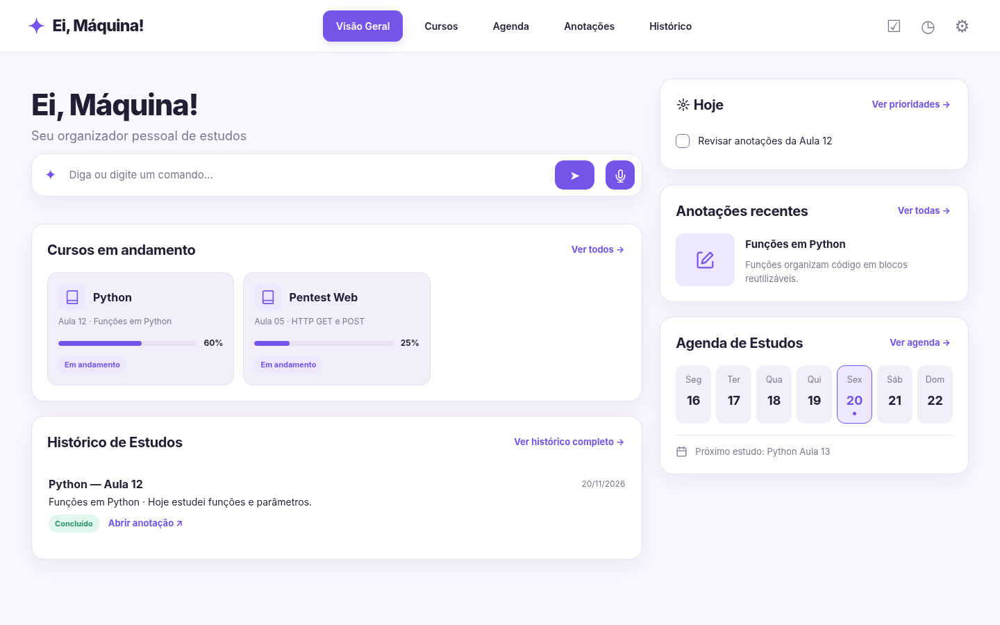
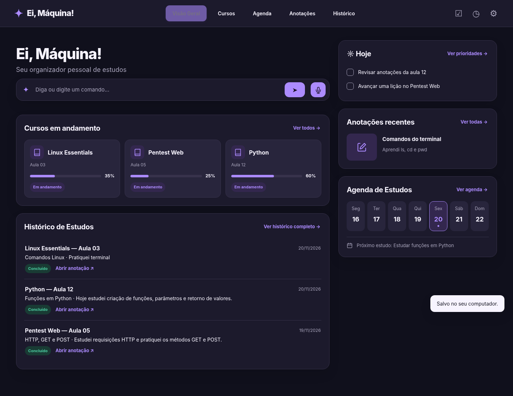

<div align="center">

# 🤖 Ei, Máquina!

**Seu assistente local para organizar estudos no Linux Mint.**

Cursos • Anotações • Histórico • Agenda • Prioridades • IA local opcional

**Python · SQLite · JavaScript · HTML/CSS · llama.cpp (opcional)**



[Tema escuro](docs/previews/dashboard-escuro.png) 

</div>

## Sobre o projeto

A **Ei, Máquina!** é uma aplicação pessoal de organização de estudos, voltada para quem acompanha cursos pela internet e quer guardar **o que aprendeu**, onde parou e quais são os próximos passos. Ela funciona no próprio computador, sem necessidade de contas externas ou mensalidades de API.

Esta é a **versão 0.2 — em desenvolvimento**. O aplicativo tem interface web acessível *somente no computador local* e integração opcional com um modelo de linguagem local. A ativação por voz **"Ei, Máquina!"** ainda não está implementada.

## Funcionalidades disponíveis

| Área | Disponível na v0.2 |
|---|---|
| Dashboard | Tema claro lilás, tema escuro, resumo dos estudos |
| Cursos e aulas | Cadastro, edição, progresso simples/detalhado, status em andamento/pausado/concluído |
| Anotações | Texto rico, código, colar imagens/prints, pastas e vínculos com aulas |
| Histórico | Curso, aula, assunto, descrição e data; **sem gráficos de horas** |
| Organização | Calendário, prioridades e notificações locais enquanto o app estiver aberto |
| Cronômetro | Sessão temporária, separada do histórico de conteúdos |
| Assistente | Comandos escritos básicos e respostas sobre dados locais |
| IA local | Opcional, via `llama.cpp` + modelo GGUF; inicialização sob demanda |
| Backup | Exportação/restauração manual |

**Ainda planejados:** palavra de ativação, reconhecimento e síntese de voz, janela flutuante nativa, inicialização automática com o Linux e novas automações seguras. Confira o [roadmap](docs/ROADMAP.md).

## Capturas de tela

| Tema claro — lilás | Tema escuro |
|---|---|
|  |  |

*As imagens ilustram a interface. Os dados da tela são exemplos, não informações reais dos usuários.*

## Requisitos

- Linux Mint ou distribuição Linux compatível.
- **Python 3.10 ou superior**.
- Navegador atualizado.
- Para IA local: `git`, `cmake`, compilador C++, `curl` e acesso à internet **apenas na instalação** do modelo.
- **Node.js e pytest não são necessários** para uso comum; servem para verificações e desenvolvimento.

## Início rápido

No terminal, dentro da pasta do projeto:

```bash
chmod +x iniciar.sh configurar_ia_local.sh
./iniciar.sh
```

O programa abrirá em [http://127.0.0.1:8765](http://127.0.0.1:8765). Para encerrar, use `Ctrl+C` no terminal.

Os dados são persistidos fora do código, em:

```text
~/.local/share/ei-maquina/
```

Isso permite atualizar a pasta do aplicativo **sem apagar seus cursos, anotações e histórico**. Antes de atualizações, recomenda-se exportar um backup pela interface.

### IA local (opcional)

Instale as ferramentas de compilação, se faltarem:

```bash
sudo apt update
sudo apt install git cmake build-essential curl python3
```

Prepare o modelo local (o instalador apresenta o destino e pede confirmação antes do download):

```bash
./configurar_ia_local.sh
./iniciar.sh
```

A configuração padrão usa **Qwen3 1.7B Q4_K_M** via `llama.cpp`, compilado sem AVX2 para funcionar em processadores mais antigos. O download do modelo é de aproximadamente **1,28 GB** e não está incluído no repositório. **O desempenho no i5-2500K ainda precisa ser medido no hardware real.**

O processo de IA é iniciado somente quando necessário e desligado após inatividade; sem a IA, o organizador continua funcionando.

[Leia as instruções completas](docs/COMECE-AQUI.md) · [Arquitetura](docs/ARQUITETURA.md) · [Segurança e privacidade](docs/SEGURANCA.md)

## Exemplos de comandos escritos

```text
Onde parei no curso Python?
Abre minhas anotações
O que estudei recentemente?
Adicionar prioridade: Revisar aula de Linux
```

Para perguntas mais amplas, instale o modelo opcional. A IA **não executa comandos de sistema** e não interpreta o conteúdo dos prints.

## Testes

```bash
python3 -m pip install -r requirements-dev.txt
python3 -m pytest -q
node --check static/app.js
bash -n iniciar.sh configurar_ia_local.sh scripts/verificar.sh
```

Ou execute `./scripts/verificar.sh` após instalar `pytest`. O CI do GitHub executa os testes em diferentes versões do Python. **Os testes da IA usam um servidor simulado; a inferência real no computador do usuário ainda precisa ser validada.**

## Organização do projeto

```text
Ei-Maquina/
├── main.py                    # Servidor HTTP local e rotas da API
├── storage.py                 # Persistência SQLite e backup
├── local_ai.py                # Controle da IA sob demanda
├── iniciar.sh                 # Inicialização do organizador
├── configurar_ia_local.sh     # Download/compilação opcionais da IA
├── static/                    # Dashboard HTML, CSS e JavaScript
├── tests/                     # Testes automatizados
├── scripts/                   # Verificações para desenvolvimento
├── docs/                      # Guias, roadmap e imagens
├── .github/workflows/          # CI automático
├── AI.md                      # Transparência sobre uso de IA no desenvolvimento
└── README.md
```

## Privacidade

O servidor da interface fica restrito a `127.0.0.1`, **sem autenticação de usuários**. Portanto, **não publique a porta nem faça port forwarding**. Seus dados de estudos, backups e modelos ficam fora do Git. Veja [SEGURANCA.md](docs/SEGURANCA.md) antes de compartilhar código ou abrir issues.

## Desenvolvimento e próximos passos

O foco atual é preservar a versão que funciona antes de implementar voz e recursos novos. Alterações devem passar pelos testes. [Roadmap detalhado](docs/ROADMAP.md) · [Histórico das versões](CHANGELOG.md) · [Uso de IA no desenvolvimento](AI.md).

**Licença:** ainda não foi escolhida. A publicação do código não concede automaticamente permissão de reutilização; definir uma licença é uma decisão separada do autor.

## Publicar no GitHub

Siga o [guia de publicação](docs/PUBLICAR-NO-GITHUB.md) para criar um repositório vazio, revisar os arquivos e fazer o primeiro `push`. **Não execute `git add` na sua pasta de dados pessoais.**
